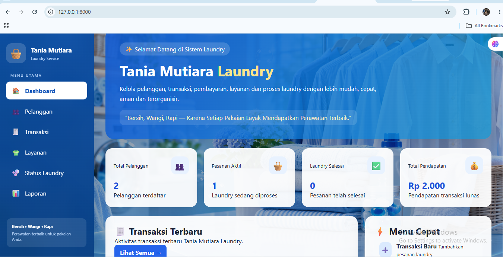

# Tania Mutiara Laundry 🧺

Tania Mutiara Laundry adalah aplikasi berbasis web yang dibuat menggunakan Laravel untuk membantu proses pengelolaan usaha laundry.

Aplikasi ini dirancang untuk mengelola data pelanggan, layanan laundry, transaksi, pembayaran, status pengerjaan laundry, dan laporan.

## ✨ Fitur Utama

- Manajemen data pelanggan
- Manajemen layanan laundry
- Transaksi laundry
- Perhitungan total harga
- Pembayaran langsung atau bayar nanti
- Metode pembayaran Tunai, Transfer, dan QRIS
- Tracking status laundry
- Laporan data laundry
- Dashboard informasi laundry

## 🛠️ Teknologi yang Digunakan

- Laravel
- PHP
- HTML
- CSS
- JavaScript
- SQLite
- Git
- GitHub

## 📌 Status Laundry

Status pengerjaan laundry meliputi:

- Diterima
- Dicuci
- Dikeringkan
- Disetrika
- Selesai
- Diambil / Dikirim

## 💳 Sistem Pembayaran

Aplikasi mendukung:

- Bayar langsung
- Bayar nanti
- Tunai
- Transfer
- QRIS
- Status Lunas / Belum Lunas

## 👩‍💻 Developer

**Tania Mutiara Panjaitan**

Informatics Student  
Interested in Web Development and Software Development.

## 🚀 Project Status

Project ini masih dalam tahap pengembangan dan akan terus diperbarui dengan fitur-fitur baru.

## 📸 Tampilan Aplikasi

### Dashboard
